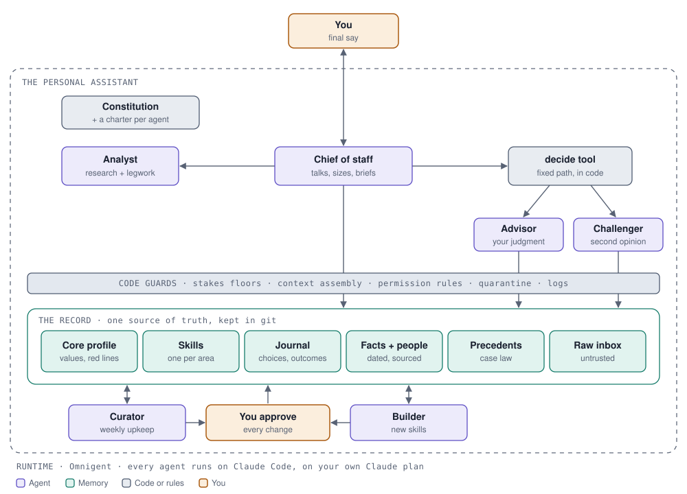

# Personal assistant

A personal assistant that learns how *you* decide, and then helps you the way you would.

It starts by interviewing you. It looks through your own email, documents and AI chats for real decisions you have made, then asks you about them in short, easy sessions: what you noticed, what you weighed, what you would never do. What you approve becomes your record. From then on, when you bring it a decision, it reads that record, checks the options against your own hard lines, and tells you what you would most likely choose, how sure it is, and why, with a second opinion that disagrees when the evidence does.

It never acts for you: it does not send, pay, book or post anything. And nothing goes into your record unless you approve it.



## Get started

You need Python 3.11 or later (with `pyyaml` and `mcp`), the `claude` command signed in to your Claude plan, Omnigent, and `tmux`. No API keys are used.

Then start with onboarding:

```bash
./pa onboard
```

This opens the onboarding chat. First it checks which of your sources it can reach, such as your mail, documents and past Claude or Codex chats, and you choose what it may read and what is off-limits. While it reads the ones you allowed, looking for real decisions you have made, it asks you the basics: your name, the lines you would never cross, and the amount of money that makes a decision a big one for you. Then it interviews you about your own decisions in sessions of about fifteen minutes. Each time it wants to add something to your record, you see it and approve or reject it with a click.

You can stop at any time. Run `./pa onboard` again later and it continues where it left off.

## Commands

In the order you will use them:

| Command | What it does |
|---|---|
| `./pa onboard` | Start onboarding, or continue it where it stopped. |
| `./pa chat` | Everyday use: talk to your chief of staff about anything, including a decision. |
| `./pa review` | The weekly review: it checks your record for what is out of date, due, or conflicting, and brings you a short list. Run it whenever you like. |
| `./pa changes` | See any changes to your record that are still waiting for your yes. |
| `./pa approve ID` | Approve one waiting change, or `all`. You can also approve in the chat. |
| `./pa reject ID` | Reject one waiting change, or `all`. |
| `./pa check` | Check that the code works. Takes a few seconds and uses no AI. |
| `./pa stop` | Stop everything when you are done. |

The agents run inside Omnigent, which `pa` starts in the background whenever a command needs it.

## How it works

You talk to three agents:

- **Onboarding** interviews you and builds your record. Behind it, a **case finder** reads your allowed sources for real decisions, and a **preparer** turns what it finds into a plan for the interview.
- **Chief of staff** is who you talk to every day. It answers from your record, runs the decision path for any real decision, records new decisions, and hands anything outside your record, like checking your mail or searching the web, to a **worker**.
- **Curator** runs the weekly review and proposes fixes for you to approve.

For a real decision, the chief of staff calls the **decide** tool, a fixed path written in code. An **analyst** gathers the evidence from your record, then an **advisor** reads it as you would and a **challenger** argues the other side, each on its own without seeing the other. A **tester** checks every explanation of your past choices against every past case, and the code, not an AI, sets the answer and how sure it is. A **builder** makes new pieces when you ask, such as a skill for one area of your life, a tracker or a reminder.

Your record holds your core profile (values, hard lines, how you want answers), your skills, a journal of your decisions and how they turned out, dated facts, the people in your life, your past rulings, and an inbox for anything that arrives from outside.

## Safeguards

These are enforced in code, not left to the agents' good behaviour:

- **It cannot act for you.** The agents you talk to have no shell, no files and no web, and none of their tools sends, pays, books or posts. The most they can do is prepare a draft for you to send yourself.
- **Your record changes only with your yes.** Agents can only propose. Past journal entries are never rewritten, and a request like "don't ask me again" is never saved as a rule.
- **Your hard lines are walls.** Any option that would cross one is removed before anything is weighed, and anything above your money line is treated as a big decision.
- **Outside messages cannot give orders.** Emails and messages are read by a separate model with no tools, and only a summary reaches the agents. Passwords, codes and card or ID numbers are blacked out before any agent sees them.
- **The worker and case finder stay in their lane.** They may write only in `workspace/` and your record's inbox, and read only there, in your Claude and Codex chats, and in folders you allow. They never read secret stores such as `~/.ssh`, never delete, ask you before sending anything, and lose web access once they have read your private data.

`kit/METHODS.md` explains the research method behind each agent and everything the code enforces.

## Where things live

```
pa                 the one command
kit/               the same for everyone: the constitution, each agent's instructions, templates
system/            the code: tools, the decision path, the policy engine, the guards
scripts/           helpers pa runs for you
docs/              the architecture diagram
workspace/         where the worker and case finder may work
record/            your own record, created on first run and never uploaded
```

Everything in the pack is generic; everything about you lives in `record/`. The pack works from any folder, and these optional settings move things elsewhere:

| Setting | What it changes |
|---|---|
| `PA_RECORD` | Keep your record in another folder, such as a private one. |
| `PA_READABLE` | Folders the case finder and worker may read, beyond your Claude and Codex chats, joined by `:`. |
| `PA_WORKSPACE` | Move the worker's working folder. |
| `PA_STATE` | Move session state and logs. |
| `OMNIGENT_SERVER` | Use an Omnigent server other than the local one. |
